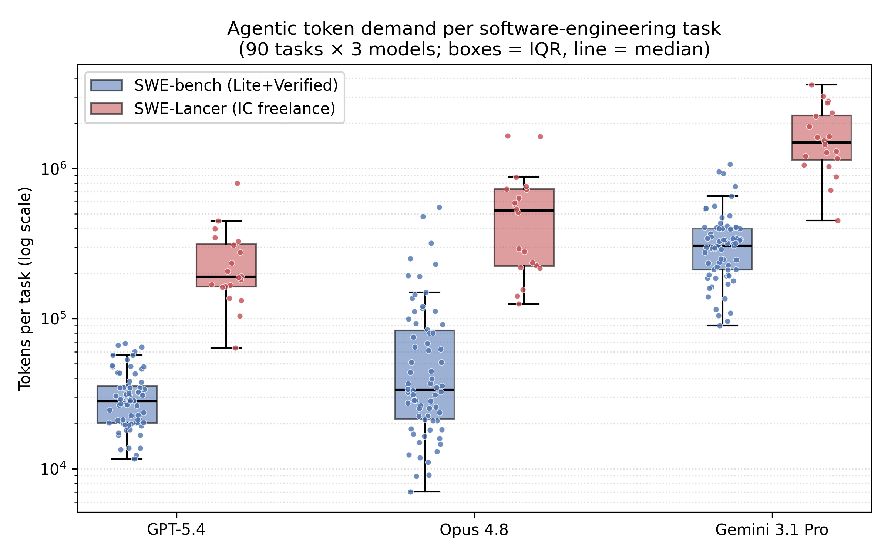
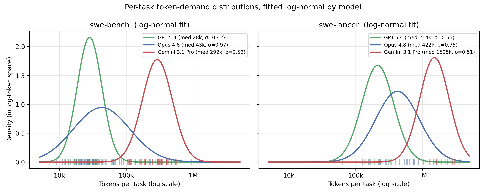
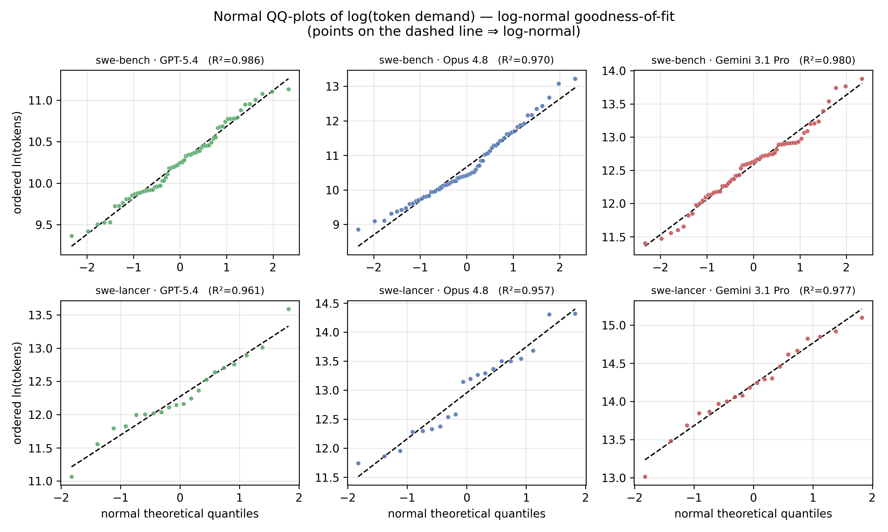
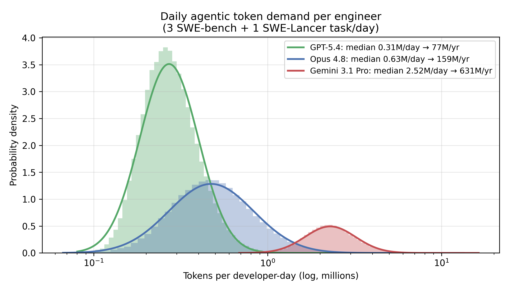

# Experiment 1 — Token Consumption of Autonomous Coding Agents

**Objective.** Empirically characterise the inference workload (token demand) required for
autonomous AI coding agents to attempt representative software-engineering tasks, in order to
parameterise the FTE-equivalent token-demand term `T_FTE` in the labor-to-infrastructure model.
The experiment measures *token consumption per task* across frontier commercial models and two task
suites of differing realism; it does **not** measure task-resolution success (grading was out of
scope — see §7).

Data collected 2026-06-23/24. Raw per-task records: `exp1_results/exp1_raw.csv`
(270 task-runs = 90 tasks × 3 models). Selection is deterministic (seed 42) and reproducible.

---

## 1. Models evaluated

One frontier model per provider, selected as the most capable coding model accessible on our API
accounts at the time of the experiment (June 2026), routed uniformly through **LiteLLM**.

| Provider | Model (API id) | Role | Input · Output · Cached ($/1M) |
|---|---|---|---|
| Anthropic | `claude-opus-4-8` | flagship coding model | 5.00 · 25.00 · 0.50 |
| OpenAI | `gpt-5.4` | accessible GPT-5-tier model (chat API)¹ | 2.50 · 15.00 · 0.25 |
| Google | `gemini-3.1-pro-preview` | frontier reasoning model | 2.00 · 12.00 · 0.20 |

¹ The intended `gpt-5.3-codex` (agentic-coding flagship) was not enabled on our OpenAI project;
`gpt-5.4` is the strongest accessible chat-API model and was used throughout.

---

## 2. Task suite and stratified sampling

To control cost while preserving task diversity, tasks were drawn by **stratified random sampling**
(seed 42) from three benchmarks. The *same* sampled task set was used for all three models, giving a
paired (within-task) comparison.

| Benchmark | n | Population | Stratification | Allocation |
|---|---|---|---|---|
| SWE-bench Lite | 30 | 300 | by repository | django 11, sympy 8, matplotlib/pytest/scikit-learn/sphinx 2 each, astropy/requests/pylint 1 each |
| SWE-bench Verified | 40 | 500 | by annotated difficulty | `15min–1h` 21, `<15min` 16, `1–4h` 3, `>4h` 0 |
| SWE-Lancer (IC SWE) | 20 | 84 | by task price band | low (≤\$500–1k) 9, mid (\$2–4k) 6, high (\$8k) 5 |
| **Total** | **90** | | | |

- **SWE-bench Lite/Verified** (`princeton-nlp/SWE-bench_{Lite,Verified}`): repository-level bug-fix
  tasks; each instance is a real GitHub issue with a held-out test patch.
- **SWE-Lancer** (Diamond split, IC SWE subset; `DCAgent2/swe-lancer` Terminal-Bench packaging of
  OpenAI's SWE-Lancer): real freelance tasks on the Expensify codebase, priced \$500–\$8,000. Only
  Individual-Contributor (IC) coding tasks were sampled; SWE-Manager (proposal-selection) tasks were
  excluded as non-agentic. Price (from the issue title) is used as a difficulty proxy.

Full instance lists are in Appendix A.

---

## 3. Agent scaffold and execution

**Scaffold.** [mini-SWE-agent](https://github.com/SWE-agent/mini-swe-agent) v2.4.2 — a minimal
bash-tool ReAct agent (system prompt → the model issues one bash command per step → observation is
fed back → repeat). Agent configuration (`swebench.yaml`): `step_limit = 250`, generic SWE
system/instance templates, observations truncated at 10k characters. Identical scaffold and config
for all models and benchmarks; only the model id differed.

**Execution environment.** Stanford **Sherlock** HPC, **CPU-only** nodes (no GPU is required for
Exp-1 — model inference is remote API). Each task's environment is an isolated container:
- *SWE-bench*: the official per-instance Docker images, run via **Apptainer** (`--environment-class
  singularity`); 4 parallel workers per (model × split) SLURM job.
- *SWE-Lancer*: per-task single-container images (`swelancer/swelancer_x86_<id>`) built into a
  writable Apptainer sandbox on node-local SSD; run sequentially via a custom driver
  (`run_swelancer.py`) that drives the mini-SWE-agent library inside the container at
  `/app/expensify`.

The agent's model calls reach the provider APIs over the network; all code execution, file editing,
and (where run) test execution occur inside the container.

---

## 4. Token-accounting methodology

mini-SWE-agent persists, per task, the full message trajectory (roles `system/user/assistant/tool`)
plus aggregate cost/step counts — but **not** per-message token counts. Token demand is therefore
*reconstructed* from the saved trajectory (`parse_trajectory.py`):

1. **Replay turn-by-turn.** Each `assistant` message is one API call whose **input** is the entire
   prior message history (system prompt + task + the growing assistant/tool transcript, re-sent every
   turn — the defining cost driver of agentic loops) and whose **output** is that message.
2. **Tokenise** every message with `tiktoken` (`o200k_base`).
3. **Additive partition** `T_task = T_input + T_output + T_tool`, where `T_output` = all generated
   (assistant) tokens; `T_tool` = the tool/observation share of cumulative input; `T_input` = the
   remaining cumulative input (system + task + assistant history).
4. **Cost calibration.**
   - *SWE-bench*: mini-SWE-agent records the true billed `instance_cost`; reconstructed tokens are
     **scaled (cost-anchored)** so that reconstructed cost equals billed cost. This makes the totals
     consistent with provider billing, which accounts for **prompt caching** (cached prefixes bill at
     ~0.1×). Reported SWE-bench tokens are thus *cache-adjusted / effective* tokens.
   - *SWE-Lancer*: the custom driver does not surface a billed cost, so tokens are the **raw
     reconstructed (tiktoken) cumulative** count and cost is *derived* as tokens × list price (no
     cache discount). SWE-Lancer token totals are therefore an **upper bound** relative to the
     cache-adjusted SWE-bench totals and are **not directly comparable in absolute magnitude**; the
     `raw_input_est`/`raw_output_est` columns (recorded for both suites) give a consistent
     cross-benchmark "tokens processed" view.
5. **Retry diagnostics** (not part of the additive partition — retries overlap input/output):
   `n_failed_tests` (count of non-zero command return codes) and `retry_frac` (token share in turns
   after the *second* failure; the first failing test is normal bug-reproduction, not a retry).

Per-task record schema is in Appendix B.

---

## 5. Results

### 5.1 Per-model token demand by benchmark

Tokens per task (mean / median / 90th percentile), mean and total cost, mean API calls (agent turns),
and mean retry fraction. SWE-bench = 70 tasks/model (cache-adjusted, billed); SWE-Lancer = 20
tasks/model (tiktoken-raw, derived cost) — see §4 for why absolute magnitudes are not directly
comparable across suites.

| Benchmark | Model | n | mean | median | P90 | $/task | total $ | calls | retry |
|---|---|---|---|---|---|---|---|---|---|
| SWE-bench | claude-opus-4-8 | 70 | 73,236 | 33,506 | 150,094 | 0.38 | 26.32 | 22 | 0.41 |
| SWE-bench | gpt-5.4 | 70 | 30,977 | 28,232 | 48,597 | 0.08 | 5.64 | 8 | 0.16 |
| SWE-bench | gemini-3.1-pro-preview | 70 | 333,669 | 305,676 | 540,415 | 0.67 | 46.74 | 52 | 0.91 |
| SWE-Lancer | claude-opus-4-8 | 20 | 555,893 | 524,152 | 872,877 | 2.85 | 57.07 | 42 | 0.29 |
| SWE-Lancer | gpt-5.4 | 20 | 250,166 | 189,944 | 397,701 | 0.63 | 12.67 | 15 | 0.24 |
| SWE-Lancer | gemini-3.1-pro-preview | 20 | 1,698,752 | 1,490,306 | 2,810,834 | 3.40 | 67.97 | 83 | 0.87 |

Aggregate: SWE-bench median **48,321** tok/task (210 runs, \$78.70); SWE-Lancer median **524,152**
tok/task (60 runs, \$137.71); **all 270 runs = \$216.41**.

### 5.2 Token composition (T_input : T_output : T_tool)

Share of total tokens by component (cumulative across turns):

| Benchmark | Model | T_input | T_output | T_tool |
|---|---|---|---|---|
| SWE-bench | claude-opus-4-8 | 42% | 1% | 58% |
| SWE-bench | gpt-5.4 | 26% | 1% | 73% |
| SWE-bench | gemini-3.1-pro-preview | 20% | 0% | 80% |
| SWE-Lancer | claude-opus-4-8 | 35% | 1% | 64% |
| SWE-Lancer | gpt-5.4 | 20% | 0% | 80% |
| SWE-Lancer | gemini-3.1-pro-preview | 14% | 0% | 86% |

**Generated (output) tokens are ≤1% of the total.** The workload is overwhelmingly *input*: the system
prompt + task + tool observations (test logs, file contents) re-sent on every turn; tool observations
alone are 58–86%. This input/context dominance is why prompt caching yields large savings (cached
prefixes bill at ~0.1×) and is central to the energy accounting — the compute is **prefill over
re-sent context, not decode**.

### 5.3 Distribution

Every cell is **right-skewed** (mean > median, long upper tail), driven by a minority of tasks that
enter long reproduce→fix→re-test loops. Ranges: SWE-bench Opus 7k–553k (median 34k, P90 150k);
SWE-Lancer gemini 449k–**3.61M** (median 1.49M, P90 2.81M). Medians are the robust central estimate
for `T_FTE`; P90/max quantify worst-case fleet provisioning. Full per-task records in
`exp1_results/exp1_raw.csv` support histograms and percentile analysis.

**Figure 1** (`exp1_results/fig_token_demand.{png,pdf}`) plots the per-task token distribution (boxes
= IQR, line = median, points = individual tasks) on a log scale, by model and benchmark — visualising
both the ~11× model spread and the SWE-bench→SWE-Lancer shift, and the heavy upper tail.

### 5.4 Distribution fitting

We model per-task token demand as **log-normal**. This choice is principled, not merely curve-fitting:

- **Generative mechanism (a multiplicative process).** Total token demand is a *product* of positive,
  approximately independent factors — task complexity × model verbosity × number of agent turns ×
  context re-send factor × retry multiplier — and each failed-test → fix → re-test cycle multiplies
  the work further. By the multiplicative form of the Central Limit Theorem, a product of many
  independent positive factors is asymptotically log-normal (its logarithm is a sum that tends to
  Gaussian). Log-normal is the canonical law for compounding, scale-free, strictly-positive
  quantities, and matches the order-of-magnitude run-to-run variance reported for agentic coding.
- **Empirical fit.** The data are strictly positive and heavy-right-tailed, spanning >1 order of
  magnitude within each cell. Kolmogorov–Smirnov tests **do not reject** log-normality (*p* =
  0.17–0.99), and log-normal **dominates a gamma alternative** (gamma is rejected for Opus/SWE-bench
  at *p* = 0.01); residuals are approximately Gaussian in log space (Figure 2).
- **Parsimony and transferability.** Two interpretable parameters — median = e^μ (geometric mean) and
  σ (geometric SD, *scale-free*) — summarise each cell. The cross-model ~10× spread appears almost
  entirely as a shift in μ at near-constant σ, so the *shape* transfers across models and is trivial
  to re-scale for sensitivity analysis (e.g. to a future model).
- **Suitability for Monte-Carlo composition (§5.5).** A closed-form per-task law lets us compose
  heterogeneous *task mixes*. A developer-day is a **sum of independent log-normals**, which has no
  closed form — so we draw from the fitted laws and simulate. Sampling the fitted distribution rather
  than resampling the 70/20 raw observations (i) smooths small-sample noise, (ii) yields full
  uncertainty bands (P10–P90) on daily and annual demand, and (iii) extrapolates the upper tail
  (P90/P99) beyond the observed maximum — required for worst-case fleet provisioning. The fitted laws
  then propagate into the downstream GPU-fleet/energy model as a *distribution*, not a point estimate.

We fit a two-parameter log-normal (location fixed at 0) by maximum likelihood to each (model ×
benchmark) cell. Parameters (median = e^μ = geometric mean; σ = standard deviation in log space; GSD =
e^σ = geometric SD):

| Benchmark | Model | median | σ (log) | GSD | mean | KS *p* (LN) | QQ R² |
|---|---|---|---|---|---|---|---|
| SWE-bench | gpt-5.4 | 28,279 | 0.42 | 1.5 | 30,949 | 0.61 | 0.986 |
| SWE-bench | claude-opus-4-8 | 42,799 | 0.97 | 2.6 | 68,691 | 0.17 | 0.970 |
| SWE-bench | gemini-3.1-pro-preview | 291,526 | 0.52 | 1.7 | 333,220 | 0.51 | 0.980 |
| SWE-Lancer | gpt-5.4 | 213,693 | 0.55 | 1.7 | 248,330 | 0.85 | 0.961 |
| SWE-Lancer | claude-opus-4-8 | 422,156 | 0.75 | 2.1 | 558,570 | 0.70 | 0.957 |
| SWE-Lancer | gemini-3.1-pro-preview | 1,504,714 | 0.51 | 1.7 | 1,711,307 | 0.99 | 0.977 |

The fitted median (geometric mean) differs slightly from the sample median (MLE weights the full
sample); both characterise central tendency. SWE-bench dispersion is larger for Opus (σ = 0.97, GSD
2.6) than for the leaner models. **Figure 2** (`fig_distfit.{png,pdf}`) overlays the fitted densities
on the data in log-token space.

**Goodness-of-fit.** Beyond the KS test, **normal QQ-plots of log(tokens)** (Figure 3,
`fig_qqplot.{png,pdf}`) provide the formal diagnostic: under log-normality the ordered log-tokens fall
on a straight line against normal theoretical quantiles. All six cells track the reference line
closely, with QQ-line **R² = 0.957–0.986** (last column above) — strong support for the log-normal
model across both task suites and all three models, with only mild deviation in the extreme upper tail
(the heaviest 1–2 tasks per cell).

### 5.5 Daily-workload model and `T_FTE`

We model a software engineer's day as a **mixture of task types**: *n*₍small₎ SWE-bench-scale fixes +
*n*₍lancer₎ SWE-Lancer-scale tasks. Following the realistic-workload assumption (one freelance-scale
task per day plus several small fixes), we set **n_small = 3, n_lancer = 1**, with 250 workdays/year.
Daily demand `D = Σ small_i + lancer` is a sum of log-normals (no closed form); we estimate its
distribution by Monte-Carlo (200,000 simulated days) from the fitted per-task distributions.

| Model | daily median | daily P10–P90 | **annual median = `T_FTE`** |
|---|---|---|---|
| gpt-5.4 | 0.31M | 0.19–0.53M | **77M tokens/FTE-yr** |
| claude-opus-4-8 | 0.63M | 0.32–1.34M | **159M tokens/FTE-yr** |
| gemini-3.1-pro-preview | 2.52M | 1.69–3.95M | **631M tokens/FTE-yr** |

**`T_FTE` ≈ 0.08–0.63 billion tokens/FTE-year**, depending on the deployed model; a central estimate
(Opus 4.8) is **~159M tokens/FTE-year**. The single SWE-Lancer task dominates the daily total (it
roughly equals the three small tasks combined), so `T_FTE` is governed by the *realistic-task*
component, not the count of small fixes — sensitivity over n_small ∈ {1,3,5} moves the Opus estimate
only 123M → 159M → 194M. **Figure 4** (`fig_daily_demand.{png,pdf}`).

> *Relation to prior estimates.* Earlier back-of-envelope figures assumed ~4M tokens/day → ~1B
> tokens/FTE-yr. Our empirically-fitted range is **0.08–0.63×** of that: measured agentic tasks are
> mostly smaller than the assumed 2.25M-token average, except the token-heavy Gemini, which approaches
> the high end. *Caveat:* SWE-Lancer tokens are tiktoken-raw (no cache discount), so the SWE-Lancer
> contribution — and hence `T_FTE` — is a mild upper bound; SWE-bench is cache-adjusted (§4).

---

## 6. Key findings

1. **Model choice dominates token demand more than task difficulty.** On identical SWE-bench tasks,
   median per-task demand spans **~11× across models** (gpt-5.4 28k, opus 34k, gemini-3.1-pro 306k).
   The gap is behavioural: gemini runs ~52 turns/task with 9 failed-test cycles and `retry_frac` 0.91
   (it repeatedly re-tests and re-iterates), versus gpt-5.4's lean 8 turns and 0.16.
2. **Real-world tasks demand far more than benchmarks.** SWE-Lancer (freelance work on a production
   codebase) median token demand is **~5–16× the matched SWE-bench median, per model** (opus
   524k/34k ≈ 16×; gpt-5.4 190k/28k ≈ 7×; gemini 1.49M/306k ≈ 5×; pooled 524k vs 48k ≈ 11×). The
   heaviest tasks exceed 3M tokens (gemini P90 2.8M, max 3.6M), squarely in the 1–3.5M tokens/task
   range reported for autonomous agents. Benchmark bug-fixes substantially *understate* the token
   demand of real software-engineering work.
3. **Demand is input/observation-bound, not generation-bound.** Generated (output) tokens are **≤1%**
   of the total; **58–86%** are tool/observation tokens re-sent across turns (§5.2). Token demand is
   thus a *prefill-over-context* problem — set by context length × turn count, highly amenable to
   caching, and the relevant quantity for the energy model is prefill compute, not decode.
4. **Cost is not the binding constraint.** All 270 runs cost ≈\$216 (SWE-bench \$78.70, SWE-Lancer
   \$137.71); per-task \$0.08–\$3.40. Even at 1M+ tokens a real task costs a few dollars — orders of
   magnitude below human labor cost; the constraint is capability/throughput, not token price.

5. **Token demand is log-normal; `T_FTE` ≈ 0.08–0.63 billion tokens/FTE-year.** Per-task demand fits a
   log-normal law (§5.4, KS *p* up to 0.99). A realistic daily mix (3 SWE-bench + 1 SWE-Lancer task,
   250 workdays) gives an annual per-engineer demand of **77M (gpt-5.4) / 159M (Opus 4.8) / 631M
   (Gemini 3.1 Pro)** tokens (§5.5) — an empirically grounded, distribution-aware `T_FTE`, dominated by
   the realistic-task component.

These motivate a **realistic, distribution-aware** token-demand parameter for `T_FTE` — the median of
a realistic task mix (weighted toward SWE-Lancer-like real work), not a single benchmark mean.

---

## 7. Limitations and threats to validity

- **Success not measured.** This experiment quantifies *token demand*, not task-resolution rate.
  Pass/fail grading (SWE-bench harness / SWE-Lancer end-to-end tests) was not run; token totals
  include both successful and unsuccessful attempts (the realistic operating condition).
- **Cross-suite comparability.** SWE-bench tokens are billing-/cache-adjusted; SWE-Lancer tokens are
  raw tiktoken reconstructions (no cache discount). Absolute SWE-Lancer totals are upper bounds; use
  the `raw_*_est` columns for like-for-like comparison (§4).
- **Tokeniser approximation.** Token splits use `tiktoken` (OpenAI vocabulary), an approximation for
  Anthropic/Google models; SWE-bench totals are nonetheless pinned to billed cost via anchoring.
- **Scaffold dependence.** Results are specific to the mini-SWE-agent ReAct scaffold (`step_limit`
  250). A different scaffold (e.g. OpenHands, more tools, parallel sub-agents) would shift absolute
  token demand, though the cross-model ordering is expected to be robust.
- **Sample size.** 30/40/20 tasks per benchmark; per-cell estimates have non-trivial variance given
  the right-skew. Medians and the raw CSV mitigate this.

---

## 8. Reproducibility

Deterministic (seed 42). Key artifacts (all in `exp1_token_consumption/`):
`sample_tasks.py` / `sample_swelancer.py` (sampling → `task_manifest.json`,
`swelancer_manifest.json`), `swebench.yaml` (agent config), `slurm/run_exp1.sbatch` +
`submit_all.sh` (SWE-bench), `slurm/run_swelancer.sbatch` + `submit_swelancer_all.sh` (SWE-Lancer),
`parse_trajectory.py` (token reconstruction), `summarize.py` (aggregation), `estimate_cost.py`
(pricing), `make_figure.py` (Fig 1), `fit_distributions.py` (§5.4–5.5 fits + Figs 2–4). Raw
trajectories were retained per task; aggregated records in `exp1_results/exp1_raw.csv`; figures in
`exp1_results/fig_*.{png,pdf}`.

---

## Appendix A — Sampled task instances (seed 42)

**SWE-bench Lite (30):** astropy__astropy-14182; django__django-11001, -11910, -13321, -13448,
-13551, -14016, -14580, -14855, -15061, -15789, -17087; matplotlib__matplotlib-23563, -23964;
psf__requests-863; pylint-dev__pylint-7228; pytest-dev__pytest-5103, -6116;
scikit-learn__scikit-learn-13496, -25747; sphinx-doc__sphinx-10451, -8273; sympy__sympy-12419,
-13031, -13895, -14308, -16988, -18189, -20639, -23262.

**SWE-bench Verified (40):** astropy__astropy-13033, -7166; django__django-10973, -11133, -11276,
-12050, -12125, -13028, -14011, -14725, -15022, -15103, -15104, -15268, -15569, -16139, -16315,
-16642, -16877, -16938; matplotlib__matplotlib-13989, -21568, -23299, -24026, -24570, -25960;
pylint-dev__pylint-8898; pytest-dev__pytest-7521; scikit-learn__scikit-learn-10844, -11578, -25747;
sphinx-doc__sphinx-10449, -8269, -8459, -9698; sympy__sympy-13647, -13757, -16766, -17655, -18211.

**SWE-Lancer IC (20), by price:** \$8,000 — 14127, 14958; \$4,000 — 14223_1; \$2,000 — 20079,
13066_1; \$1,000 — 18909_734, 19135_873, 18157_893, 19362_850, 25570_780, 19023_868; \$500 —
28059_803, 27156_665, 28565_1001, 28093_799, 27029_876, 28087_800, 29598_896, 28153_817, 29163_589.

## Appendix B — Per-task data dictionary (`exp1_results/exp1_raw.csv`)

`model`, `instance_id`, `api_calls` (agent turns); `T_input`, `T_output`, `T_tool`, `total_tokens`
(additive partition, §4); `cost_usd` (billed for SWE-bench, derived for SWE-Lancer);
`n_failed_tests`, `retry_frac` (diagnostics); `raw_input_est`, `raw_output_est`, `raw_cost_est`
(uncalibrated tiktoken reconstruction — use for cross-suite comparison); `anchor_factor`
(billed÷reconstructed scaling; 1.0 when no billed cost); `resolved` (blank — grading not run).

## Appendix C — Per-task token demand, SWE-Lancer (total tokens by model)

Tokens per task for the 20 sampled SWE-Lancer IC tasks (tiktoken-reconstructed, §4). Note that the
freelance **price is a weak predictor of token demand** — some \$500 tasks exceed \$8,000 tasks —
because price reflects payout, not agent difficulty. Gemini 3.1 Pro is consistently the heaviest.

| Instance | Price | GPT-5.4 | Opus 4.8 | Gemini 3.1 Pro |
|---|---|---|---|---|
| 14127 | \$8,000 | 346,150 | 218,822 | 1,533,918 |
| 14958 | \$8,000 | 234,299 | 278,929 | 1,165,763 |
| 14223_1 | \$4,000 | 166,385 | 727,419 | 449,346 |
| 13066_1 | \$2,000 | 397,701 | 155,464 | 2,810,834 |
| 20079 | \$2,000 | 328,410 | 730,274 | 1,630,266 |
| 18157_893 | \$1,000 | 163,603 | 141,590 | 879,570 |
| 18909_734 | \$1,000 | 169,123 | 125,885 | 1,206,190 |
| 19023_868 | \$1,000 | 63,935 | 226,424 | 718,509 |
| 19135_873 | \$1,000 | 104,326 | 575,192 | 1,033,128 |
| 19362_850 | \$1,000 | 191,654 | 760,629 | 2,742,032 |
| 25570_780 | \$1,000 | 181,578 | 236,438 | 1,303,534 |
| 27029_876 | \$500 | 132,478 | 511,174 | 1,280,678 |
| 27156_665 | \$500 | 207,553 | 1,651,031 | 1,614,503 |
| 28059_803 | \$500 | 161,830 | 872,877 | 3,024,115 |
| 28087_800 | \$500 | 308,956 | 591,778 | 3,607,350 |
| 28093_799 | \$500 | 446,580 | 1,631,357 | 1,446,693 |
| 28153_817 | \$500 | 797,770 | 637,502 | 1,052,977 |
| 28565_1001 | \$500 | 188,235 | 537,129 | 1,903,763 |
| 29163_589 | \$500 | 275,744 | 291,869 | 2,228,249 |
| 29598_896 | \$500 | 137,020 | 216,082 | 2,343,613 |

(Per-task SWE-bench records — 70 instances × 3 models — are in `exp1_results/exp1_raw.csv`.)
