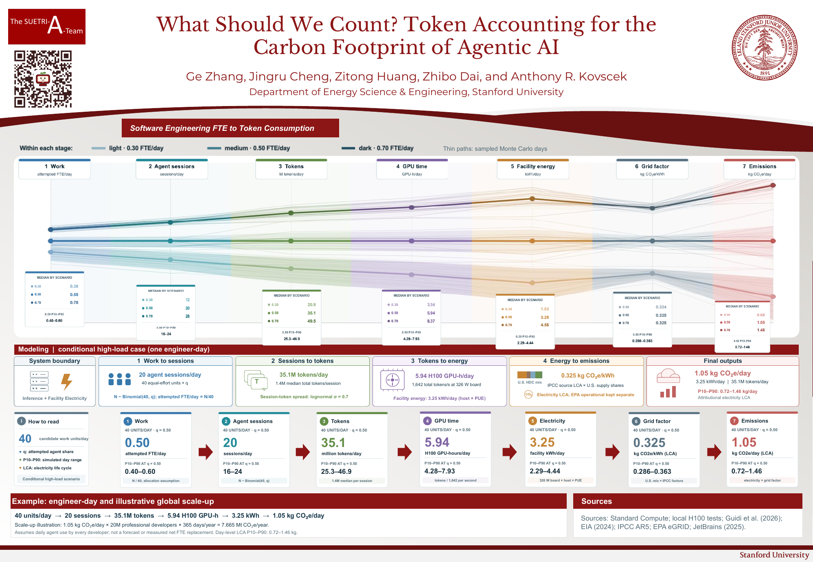

# What Should We Count? Token Accounting for the Carbon Footprint of Agentic AI

[Editable AGU 2026 poster](AGU_Token/AGU26_Token_GeoZhang.pptx) · [Poster PDF](AGU_Token/AGU26_Token_GeoZhang.pdf) · [Numerical methods and source ledger](AGU_Token/numerical/README.md)

## Project summary

This research connects software-engineering work assigned to AI agents with token demand, measured open-model GPU service, facility electricity, and electricity-supply emissions. The poster shows a **conditional high-load scenario**, with Monte Carlo variation at each stage. Its starting quantity is *attempted work allocation*, not observed labor replacement. The GPU and emissions results are **benchmark-equivalent estimates**, not measurements of a commercial agent provider's data center.

The central poster case assumes one engineer-day contains 40 equal-human-effort candidate work units. A target allocation of `q = 0.50` means an agent attempts about half of that work. Each delegated unit is assumed to launch one full agent session; that mapping is a deliberately demanding scenario, not an observed task-to-session ratio. We use a published median of 1.4 million total tokens per session and a measured local H100 serving cell for the hardware conversion. Each of the 13 high-load scenarios has 10,000 Monte Carlo draws with a fixed seed.

| Stage | Central case per engineer-day | Conditional P10–P90 | Basis |
|---|---:|---:|---|
| Attempted work | 0.50 FTE/day | 0.40–0.60 | `N ~ Binomial(40, 0.50)`; equal effort per unit assumed |
| Agent sessions | 20/day | 16–24 | One session per delegated unit assumed |
| Total tokens | 35.1 million/day | 25.3–46.9 million | [Standard Compute](https://standardcompute.com/agent-burn-index) session median; spread assumed |
| H100 service | 5.94 GPU-hours/day | 4.28–7.93 | Local Qwen3-Coder-30B-A3B benchmark: 1,642 total tokens/s |
| Facility electricity | 3.25 kWh/day | 2.29–4.44 | 326 W measured board power; host factor and PUE assumed |
| U.S. supply factor | 0.325 kg CO₂e/kWh | 0.286–0.363 | Data-center source weights and IPCC life-cycle factors |
| Electricity emissions | 1.05 kg CO₂e/day | 0.72–1.46 | Facility kWh × source-weighted factor |

These P10–P90 ranges describe variation **within the chosen model and assumptions**. They are not confidence intervals for real-world engineering substitution or provider emissions. The poster's 7.665 Mt CO₂e/year global arithmetic illustration additionally assumes 20 million developers all use agents on every one of 365 days; it is **not a forecast**.

### Accounting chain

For candidate-unit count `A`, attempted share `q`, agent-session tokens `T_s`, measured throughput `R`, board power `P`, host multiplier `u`, power usage effectiveness `PUE`, electricity-source shares `p_s`, and source life-cycle factors `EF_s`:

```text
N             ~ Binomial(A, q)             attempted agent sessions/day
F_attempted   = N / A                      attempted FTE/day, if units have equal human effort
T             = Σ_session T_s              total tokens/day
GPU_hours     = T / R / 3,600              benchmark GPU-hours/day
E_facility    = (T / R) × P × u × PUE / 3,600,000    kWh/day
I_grid        = Σ_source p_s × EF_s         kg CO₂e/kWh
C_electricity = E_facility × I_grid         kg CO₂e/day
```

The main grid scenario uses [Guidi et al.'s U.S. hyperscale data-center electricity attribution](https://arxiv.org/html/2606.05420v1), an explicitly labeled [EIA 2024 renewable submix proxy](https://www.eia.gov/electricity/annual/table.php?t=epa_03_01_b.html), and [IPCC source-specific life-cycle factors](https://www.ipcc.ch/site/assets/uploads/2018/02/ipcc_wg3_ar5_annex-iii.pdf). [EPA eGRID](https://www.epa.gov/egrid/summary-data) is a **separate operational-emissions comparison**. Life-cycle and operational factors must not be added together. Marginal emissions are a different question and are not inferred from the annual source mix.

## Evidence and limits

The project contains local agent-token traces and open-model GPU measurements, published source tables, and analyst assumptions. The [source audit](AGU_Token/numerical/SOURCE_AUDIT.md), [reference register](AGU_Token/numerical/REFERENCES.md), and [high-load reassessment](AGU_Token/numerical/HIGH_LOAD_REASSESSMENT_2026-11-01.md) distinguish these evidence levels. The present model does **not** establish completed task counts, acceptance rates, human review time saved, net FTE replacement, closed-model serving hardware, idle fleet allocation, or marginal grid impact. Hardware manufacture, data-center construction, and model training are outside the poster's primary system boundary.

The [empirical experiment](Experiment/README.md) supplies selected agent-token traces and A100/H100/H200 serving measurements. These measurements characterize the chosen tasks, models, and serving settings; they do not validate the poster's assumed one-session-per-delegated-unit mapping.

## Repository guide

| Path | Contents |
|---|---|
| [`AGU_Token/`](AGU_Token/) | Current editable poster, PDF, preview, and numerical study. |
| [`AGU_Token/numerical/`](AGU_Token/numerical/) | Seven-stage equations, input and source CSVs, Monte Carlo code, summaries, and poster figures. |
| [`Experiment/`](Experiment/) | Relevant task-token and GPU measurements, methods, and source code used to support the poster model. |

## Reproduce the poster calculations

Run from the repository root with Python 3. The numerical model uses the standard library. Figure PNG conversion uses PyMuPDF when installed.

```bash
python3 AGU_Token/numerical/run_seven_stage.py
python3 AGU_Token/numerical/run_high_load_sensitivity.py
python3 AGU_Token/numerical/run_grid_sensitivity.py
python3 AGU_Token/numerical/validate_seven_stage.py
python3 AGU_Token/numerical/make_poster_figures.py
python3 AGU_Token/numerical/make_high_load_figure.py
```

The run scripts regenerate the large per-draw CSV files locally. Those deterministic intermediate files, virtual environments, credentials, and presentation build caches are excluded from the public repository. The compact summary CSVs, source ledgers, final figures, and editable poster are included. The original experiment requires cluster or API access to rerun; its relevant aggregated data, per-cell GPU measurements, and acquisition code are included.

## Status

This is an unfinished AGU 2026 research project and poster draft. The present results are suitable for inspecting the accounting method and sensitivities; a measured labor-substitution footprint requires accepted-task outcomes and provider or instrumented serving data on the same workload.

## License, citation, and archival deposit

Project-authored source code is released under the [MIT License](LICENSE). Original research datasets, scientific text, and figure/poster content are released under [CC BY 4.0](LICENSE-DATA.md), with third-party material and marks excluded as described there. Citation metadata are in [CITATION.cff](CITATION.cff); no DOI has been assigned yet.

The [Stanford Digital Repository deposit plan](SDR_DEPOSIT.md) contains draft metadata and the sequence for archiving a future GitHub release with a DOI. The repository is still a working draft, so an archival release has not been created.
